<p align="center">
  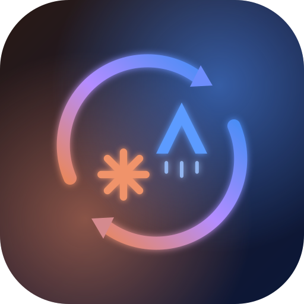
</p>

<h1 align="center">Claude2Antigravity</h1>

<p align="center">
  <b>Your Claude Code skills, plugins, agents, MCP servers and conversations - inside Google Antigravity.</b><br/>
  <i>Hit your Claude usage limit? Open Antigravity and keep working, with everything you had in Claude.</i>
</p>

<p align="center">
  <a href="https://m8ven.ai/mcp/hassenchaaben/claude-to-antigravity?s=readme"></a>
  <a href="https://github.com/HassenChaaben/claude-to-antigravity/releases"></a>
  <a href="https://antigravity.google"></a>
  <a href="https://claude.com/claude-code"></a>
  <a href="https://www.agensi.io/skills/claude2antigravity"></a>
  <a href="https://github.com/HassenChaaben/claude-to-antigravity/actions/workflows/tests.yml"></a>
  <a href="LICENSE"></a>
  
  
</p>

<p align="center">
  <a href="#-quick-start"><b>Quick Start</b></a> •
  <a href="#-community-vs-pro"><b>Community vs Pro</b></a> •
  <a href="#-what-gets-synced"><b>What gets synced</b></a> •
  <a href="#-proof"><b>Proof</b></a> •
  <a href="#-performance"><b>Performance</b></a> •
  <a href="#-privacy--security"><b>Privacy</b></a>
</p>

<p align="center">
  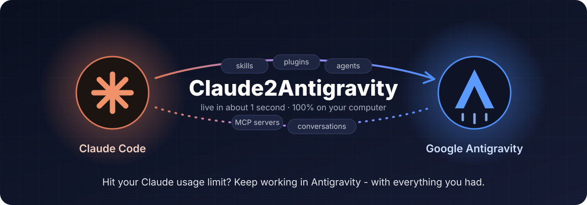
</p>

> [!TIP]
> ⚡ **Pro keeps Antigravity in sync by itself, 24/7 - [$3.99 on Agensi](https://www.agensi.io/skills/claude2antigravity), one payment.**
> Install a skill in Claude and it is in Antigravity **about a second later**, with a notification. When Claude says
> *"usage limit reached"*, Pro writes a **"continue here" brief** (project, git status, plan, todo list, last messages) and
> Antigravity picks it up in your next request. It also brings your **Claude Desktop chats**, lets you **search every
> conversation**, and hides e-mails and keys in synced text.
> Passed the Agensi security scan with 0 findings · runs only on your computer · no network calls.
> **[👉 Get Pro on Agensi](https://www.agensi.io/skills/claude2antigravity)** - or use the free Community edition below.

---

## 📑 Table of Contents

- [💡 Why](#-why)
- [⚙️ How it works](#️-how-it-works)
- [💎 Community vs Pro](#-community-vs-pro)
- [⚡ Quick Start](#-quick-start)
- [📦 Installation](#-installation)
- [🗂️ What gets synced](#️-what-gets-synced)
- [✅ Proof](#-proof)
- [🚀 Performance](#-performance)
- [🛡️ Privacy & security](#️-privacy--security)
- [⚠️ Troubleshooting & FAQ](#️-troubleshooting--faq)
- [🗺️ Roadmap](#️-roadmap)
- [🏗️ Repository layout](#️-repository-layout)
- [📜 License](#-license)

---

## 💡 Why

You build up a lot in Claude Code: skills, plugins, agents, MCP servers - and hours of conversation about your
project. Then Claude hits its usage limit, and you have to wait. **Google Antigravity** could keep going, but it
knows none of it: your skills are missing, your plugins use another format, and it has no idea what you were doing.

**Claude2Antigravity** fixes that. It copies everything from Claude into Antigravity **in Antigravity's own formats**,
and writes your Claude conversations where Antigravity reads them - so you can say *"continue what I was doing in
Claude"* and it can.

---

## ⚙️ How it works

```
┌──────────────────────────────┐        ┌───────────────────────┐        ┌─────────────────────────────────┐
│ CLAUDE                       │        │ CLAUDE2ANTIGRAVITY    │        │ GOOGLE ANTIGRAVITY              │
│ ~/.claude/skills             │        │ 1. find   (exact      │        │ ~/.gemini/config/skills         │
│ ~/.claude/plugins (installed)│ ─────▶ │    installed version) │ ─────▶ │ ~/.gemini/config/plugins + json │
│ ~/.claude/agents             │        │ 2. convert formats    │        │ ~/.gemini/config/agents         │
│ ~/.claude.json  (MCP)        │        │ 3. copy changes only  │        │ ~/.gemini/config/mcp_config.json│
│ ~/.claude/projects/*.jsonl   │        │ 4. remove what you    │        │ memory/claude2antigravity/ +    │
│ Claude Desktop chats (Pro)   │        │    uninstalled        │        │ a short block in GEMINI.md      │
└──────────────────────────────┘        └───────────────────────┘        └─────────────────────────────────┘
          Community: you run `claude2agy sync`  ·  Pro: a light background watcher does it within ~1 s
```

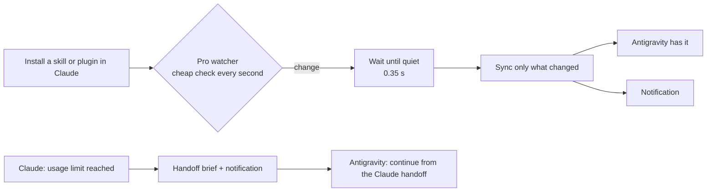

**Safe by design**

- Only items **Claude2Antigravity installed itself** are ever updated or removed (recorded in `~/.claude2antigravity/state.json`).
- An Antigravity item with the same name that you made yourself is **left alone** (use `--adopt` to let the tool manage it).
- If you edited a synced copy inside Antigravity, it is **kept** when the original disappears from Claude.
- `CLAUDE.md` is **never** modified. In `GEMINI.md` only one clearly marked block is written.
- `--dry-run` shows everything before anything changes; `uninstall` takes it all back.

---

## 💎 Community vs Pro

- **Community edition** - free, MIT, on GitHub. You run the sync when you want.
- **Pro edition** - [$3.99 on Agensi](https://www.agensi.io/skills/claude2antigravity). Runs by itself and adds the features that matter when you switch tools in a hurry.

| Feature | Community (free) | Pro ($3.99) |
|---|:---:|:---:|
| Skills, plugins (converted), agents, MCP servers → Antigravity | ✅ when you run it | ✅ **automatically, ~1 s** |
| Claude Code conversations readable in Antigravity | ✅ | ✅ live |
| `--dry-run`, `status`, `doctor`, `uninstall`, WSL support | ✅ | ✅ |
| 24/7 background sync (0.3 ms checks, < 1 % CPU) | ❌ | ✅ |
| Notification when something is synced | ❌ | ✅ |
| Starts with Windows / macOS / Linux, self-healing watchdog | ❌ | ✅ |
| Your latest Claude work added to **every** Antigravity request | ❌ | ✅ |
| **Usage-limit handoff**: "continue here" brief + notification | ❌ | ✅ |
| Claude **Desktop app** chats in Antigravity | ❌ | ✅ |
| Full-text **search** over every Claude conversation | ❌ | ✅ |
| Privacy filter: e-mails, keys and tokens hidden in synced text | ❌ | ✅ |
| Claude plugin hooks translated to Antigravity hooks | ❌ | ✅ |

<p align="center">
  <a href="https://www.agensi.io/skills/claude2antigravity"></a><br/>
  <sub>✅ <i>0 findings in the Agensi security pre-scan · no network access · your data stays on your computer</i></sub>
</p>

---

## ⚡ Quick Start

### Option 1: ask your agent (Antigravity or Claude Code)

After [installing](#-installation), just say:

> *"Sync my Claude skills and conversations to Antigravity."*

The `claude2antigravity` skill shows you a preview first, then syncs.

### Option 2: command line

```bash
git clone https://github.com/HassenChaaben/claude-to-antigravity.git
cd claude-to-antigravity
python install.py          # installs the skill for Claude Code + Antigravity and shows a preview
claude2agy sync            # or: python skills/claude2antigravity/scripts/c2a.py sync
```

Then, in Antigravity, start a new conversation and say *"continue what I was doing in Claude"*.

### Pro

Download the zip from [Agensi](https://www.agensi.io/skills/claude2antigravity), unzip it into `~/.claude/skills/claude2antigravity`, then:

```bash
python ~/.claude/skills/claude2antigravity/scripts/c2a.py setup
```

One command: installs the program, registers the Antigravity hook, runs the first sync and starts the live sync
(with auto-start). Already used another sync tool? Use `setup --adopt` so Claude2Antigravity takes over its items.

---

## 📦 Installation

| Requirement | Version | Note |
|---|---|---|
| Python | 3.10+ | standard library only - **no packages to install** |
| Claude Code | any | the source of your skills, plugins and conversations |
| Google Antigravity | any | reads `~/.gemini/config` |
| OS | Windows, macOS, Linux | WSL: Claude inside running WSL distros is included |

```bash
python install.py                    # skill for Claude Code + Antigravity, then a sync preview
python install.py --target claude    # or: antigravity, both (default)
python install.py --pip              # also adds the `claude2agy` command (pip --user)
python install.py --sync             # run the first sync right away
```

Windows: `.\install.ps1` · macOS/Linux: `./install.sh` (same options).

**Or with Docker** (image on [GitHub Packages](https://github.com/HassenChaaben/claude-to-antigravity/pkgs/container/claude2antigravity)):

```bash
docker run --rm -v ~/.claude:/root/.claude -v ~/.claude.json:/root/.claude.json   -v ~/.gemini:/root/.gemini -v ~/.claude2antigravity:/root/.claude2antigravity   ghcr.io/hassenchaaben/claude2antigravity sync --dry-run
```

<details>
<summary><b>🔧 Commands</b></summary>

| Command | What it does |
|---|---|
| `claude2agy sync` | copy every change from Claude into Antigravity |
| `claude2agy sync --dry-run` | show what would change, change nothing |
| `claude2agy sync --adopt` | also take over same-named items that are already in Antigravity |
| `claude2agy sync --no-conversations` | skills/plugins/agents/MCP only |
| `claude2agy status` | what is synced and when |
| `claude2agy doctor` | check the setup |
| `claude2agy uninstall` | remove everything this tool added (your own items stay) |
| `claude2agy setup` · `watch` · `search` · `handoff` · `autostart` | **Pro** |

</details>

<details>
<summary><b>⚙️ Settings</b> (optional) - <code>~/.claude2antigravity/config.json</code></summary>

```json
{
  "exclude_projects": ["client-x", "secret-project"],
  "wsl": true,
  "notifications": true,
  "redact": true,
  "desktop": true,
  "search": true
}
```

`exclude_projects` keeps conversations from matching project folders out of Antigravity. The last four are Pro settings.

</details>

---

## 🗂️ What gets synced

| From Claude | To Antigravity (`~/.gemini/config`) | Details |
|---|---|---|
| `~/.claude/skills/*` · skills synced from claude.ai / Desktop | `skills/<name>/` | the **whole folder** - an edit to any script is synced, files you delete disappear too |
| Installed plugins | `plugins/<name>/` | **exact installed version** (from `installed_plugins.json`), disabled plugins skipped, Antigravity `plugin.json`, enabled in `config.json`; bundled skills also listed in `skills/` (your own skill wins on a name clash) |
| Plugin `.mcp.json` | `plugins/<name>/mcp_config.json` | URL servers → `serverUrl`, `npx` → `npx.cmd` on Windows, `${CLAUDE_PLUGIN_ROOT}` resolved |
| `~/.claude/agents/*.md` | `agents/<name>.md` | name + description kept, Claude-only fields dropped |
| User MCP servers in `~/.claude.json` | `mcp_config.json` | added next to yours; an existing server with the same name is **never** changed |
| Conversations `~/.claude/projects/*/*.jsonl` | `memory/claude2antigravity/` | `INDEX.md` + one file per session (last 40 turns, todo list), and a ≤ 6 KB block in `GEMINI.md` with your latest sessions |
| Claude Desktop chats *(Pro)* | `memory/claude2antigravity/sessions/claude-desktop-chats/` | read offline from the Desktop app's local storage, kept in a permanent ledger |
| *"usage limit reached"* *(Pro)* | `memory/claude2antigravity/HANDOFF.md` | project folder, git status, latest plan, todo list, last turns |

---

## ✅ Proof

Everything below is real output from a Windows 11 laptop - unedited text, rendered as images.

**Live sync on a real PC (Pro).** A skill installed in Claude Code is in Antigravity seconds later; uninstalling removes it; `CLAUDE.md` is never touched:

<p align="center">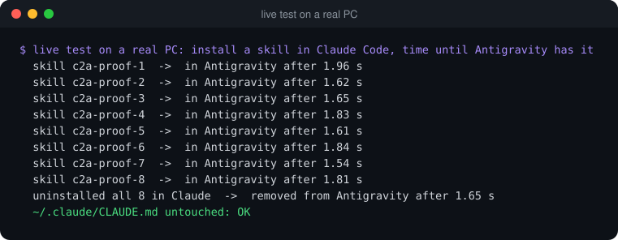</p>

**The notification** (the real window, captured on its own):

<p align="center">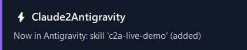</p>

**Health check and status after installing Pro** (140 skills, 31 plugins and 1 agent managed):

<p align="center">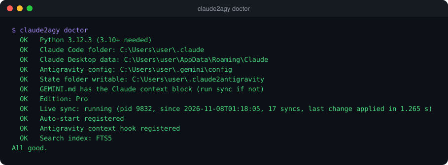<br/><br/>
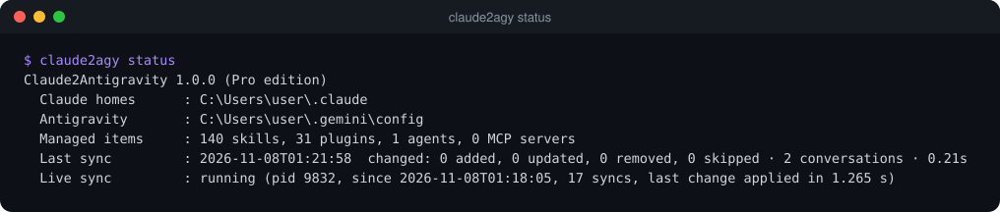</p>

**What Antigravity shows afterwards** - Claude's plugins, skills and agents in Antigravity's own menus:

<table>
<tr>
<td width="50%">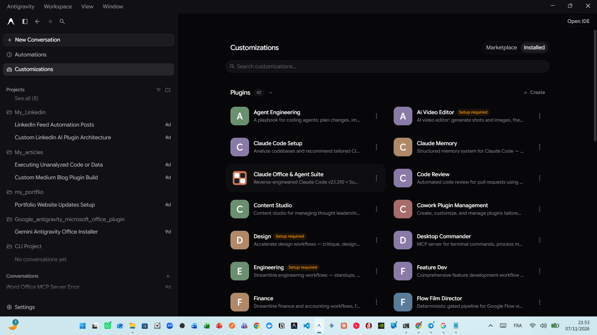</td>
<td width="50%">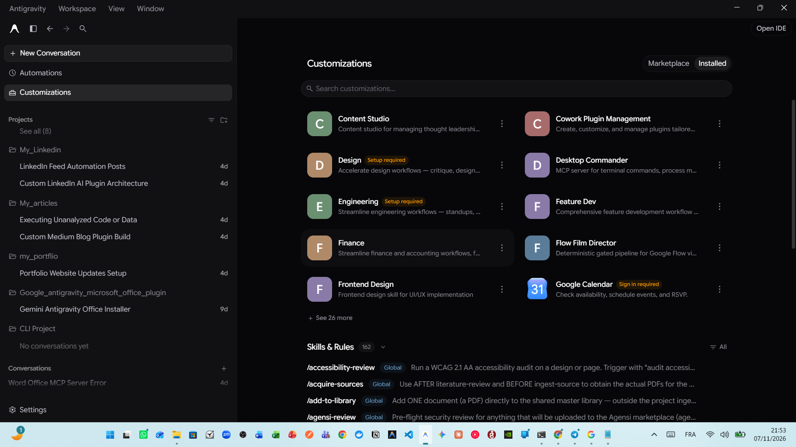</td>
</tr>
<tr>
<td colspan="2" align="center">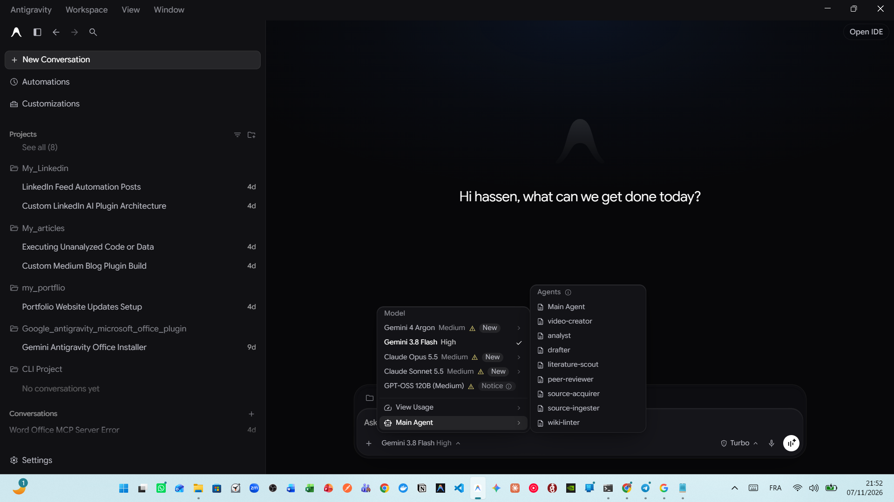</td>
</tr>
</table>

**Tests** - 26 Community tests (run on Windows, macOS and Linux in CI) and 16 Pro tests:

<p align="center">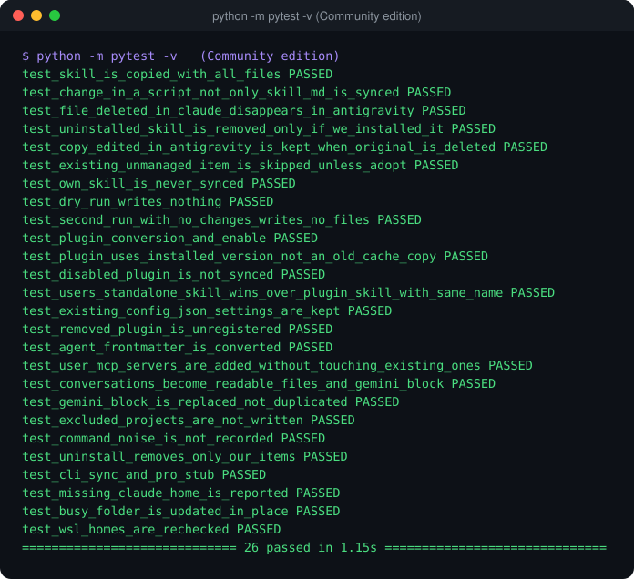 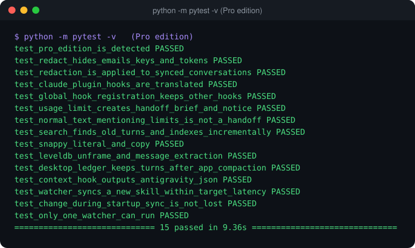</p>

**Security** - the Agensi security pre-scan ([agensi.io/security](https://www.agensi.io/security) checks) finds nothing:

<p align="center">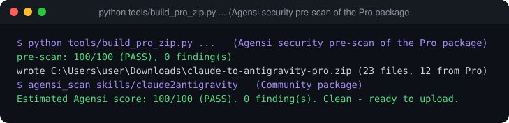</p>

---

## 🚀 Performance

Measured with [`tools/bench.py`](tools/bench.py) on a **large** synthetic setup - 200 skills, 50 plugins (150 bundled
skills), 30 agents and 1,000 conversations - three runs on a Windows 11 laptop with other apps open.
Raw numbers: [`docs/benchmark.json`](docs/benchmark.json).

<!-- BENCH:START -->
| Measure | Result (3 runs) | Target |
|---|---|---|
| New skill in Claude → in Antigravity (median) | **1.21 – 1.35 s** | < 2.5 s ✅ |
| New skill in Claude → in Antigravity (p95) | **2.04 – 2.41 s** | < 2.5 s ✅ |
| New Claude message → in Antigravity | **1.42 – 2.69 s** | - |
| Check done every second | **0.16 – 0.34 ms** | < 20 ms ✅ |
| Memory of the live sync | **33.4 – 33.8 MB** | < 40 MB ✅ |
| CPU while idle (this large setup) | **1.2 – 1.67 %** | < 2 % ✅ |
| Files written while nothing changes (30 s) | **0** | 0 ✅ |
| Sync when nothing changed (full check) | **0.498 – 0.844 s** | - |
| First sync ever (430 items + 1,000 conversations) | **11.31 – 16.85 s** | one time |
<!-- BENCH:END -->

**On a normal setup** (the author's PC: 17 skills, 31 plugins, live Claude session): the live sync uses **< 1 % CPU
and about 22 MB of memory**, and writes **nothing** to disk while nothing changes.

How it stays light:

- **Every second:** about 5 folder timestamps are read (a folder's time changes when something is added to or removed from it) plus the 1-3 conversations you are actively writing. Directory listings come with sizes and times for free on Windows (`os.scandir`).
- **Every 5 seconds:** each skill's top-level files and the list of all conversations. **Every 15 seconds:** a deep check inside skill folders.
- After a change, it waits for **0.35 s of quiet**, then syncs **only what changed**: conversations are read from the byte where the last read stopped, only changed session files are rewritten, and skills whose folders did not change are not even walked.

---

## 🛡️ Privacy & security

- **No network access at all.** No telemetry, no updates checks, no uploads. Nothing leaves your computer.
- **No environment variables, no secrets** read or stored.
- **Reads** only Claude's own folders; **writes** only to `~/.gemini/config` and `~/.claude2antigravity`.
- **Starts programs** only with argument lists, never through a shell: `wsl.exe -l` (find Claude inside running WSL). Pro also: Task Scheduler / launchctl / systemctl (auto-start, at setup), `git status` (handoff brief), and its notification window.
- MCP server entries from `~/.claude.json` can contain **your own API keys** in their `env` block; they are copied as they are into Antigravity's `mcp_config.json` **on the same computer**, so the servers keep working.
- See [SECURITY.md](SECURITY.md). Report a vulnerability through a private GitHub security advisory.

---

## ⚠️ Troubleshooting & FAQ

### Q: What happens when Claude hits its usage limit? *(Pro)*
**A:** Pro notices Claude's "usage limit reached" message, writes a handoff brief (project, branch, git status, plan,
todo list, last messages) to `~/.gemini/config/memory/claude2antigravity/HANDOFF.md` and shows a notification.
In Antigravity, just say **"continue from the Claude handoff"**. In the Community edition, run `claude2agy sync` and
say *"continue what I was doing in Claude"* - Antigravity reads the synced session files.

### Q: Will it overwrite or delete my own Antigravity skills?
**A:** No. It only updates or removes items it installed itself. Same-named items you made are left alone, and a
synced copy you edited inside Antigravity is kept.

### Q: Does it send my data anywhere?
**A:** No. It makes no network calls. Everything is read and written on your own computer. Pro also hides e-mail
addresses, API keys and tokens in synced conversation text.

### Q: Does it slow down my computer? *(Pro live sync)*
**A:** No. The background check takes under 1 ms per second and about 20-35 MB of memory, with no disk writes while
nothing changes. A new skill appears in Antigravity about 1-2 seconds after you add it in Claude
(see [Performance](#-performance)).

### Q: What is the difference between the free version and Pro?
**A:** The free Community edition (this repo) syncs when you run it by hand. [Pro](https://www.agensi.io/skills/claude2antigravity)
syncs 24/7 by itself and adds notifications, auto-start, the usage-limit handoff, live context in every Antigravity
request, Claude Desktop chats, search and the privacy filter.

### Q: Many items say "skipped (already in Antigravity, not managed)".
**A:** Antigravity already has items with those names (installed by hand or by another tool). They are never
overwritten without your OK. Run `claude2agy sync --adopt` once to let Claude2Antigravity manage them from now on.

### Q: I synced, but Antigravity does not show the new skill.
**A:** Start a **new** Antigravity conversation. New plugins and MCP servers may need an Antigravity restart.

### Q: Does it change my `CLAUDE.md`?
**A:** No, never. Only a clearly marked block in `~/.gemini/config/GEMINI.md` is written, and `uninstall` removes it.

### Q: I use Claude Code inside WSL.
**A:** Claude homes inside **running** WSL distros are included automatically (WSL is never started just for this).
Turn it off with `"wsl": false` in the settings.

### Q: How do I remove everything?
**A:** `claude2agy uninstall`. It removes only what the tool added (and, in Pro, the auto-start task and the hook).

### Q: Something looks wrong.
**A:** Run `claude2agy doctor` and look at `~/.claude2antigravity/log.txt`, then
[open an issue](https://github.com/HassenChaaben/claude-to-antigravity/issues/new?template=bug_report.md).

---

## 🗺️ Roadmap

More Pro features in progress (Pro buyers get them as free updates):

- **Two-way handoff**: Antigravity → Claude (when you come back, Claude knows what Antigravity did).
- **More sources**: Cursor, Codex CLI and Gemini CLI skills and rules.
- **Tray icon** with pause / resume and the last synced items.
- **Weekly report**: what was synced, what you worked on, across both tools.
- **Per-project profiles**: choose which skills and plugins each Antigravity workspace gets.

Have an idea? [Open a feature request](https://github.com/HassenChaaben/claude-to-antigravity/issues/new?template=feature_request.md).

---

## 🏗️ Repository layout

```
claude-to-antigravity/
├── skills/claude2antigravity/        # the skill (Claude Code + Antigravity) - also the Python package
│   ├── SKILL.md
│   └── scripts/
│       ├── c2a.py                    # run without installing: python scripts/c2a.py sync
│       └── claude2antigravity/       # paths, sources, convert, conversations, memory, sync, cli
├── tests/                            # pytest, fake ~/.claude and ~/.gemini in temporary folders
├── tools/
│   ├── bench.py                      # performance benchmark (synthetic large setup)
│   ├── build_pro_zip.py              # Agensi package: Community + private Pro files + security pre-scan
│   ├── terminal_svg.py               # renders real command output for the README proofs
│   └── capture_window.ps1, capture_popup.py, screenshot.ps1
├── docs/assets/                      # banner, proof images ·  docs/benchmark.json
├── .claude-plugin/                   # Claude Code plugin + marketplace manifests
├── plugin.json                       # Antigravity plugin manifest
├── install.py / install.ps1 / install.sh
├── pyproject.toml                    # `pip install .` → claude2agy command
└── CHANGELOG.md · SECURITY.md · LICENSE
```

Run the tests: `python -m pytest -q` · benchmark: `python tools/bench.py`.

---

## 📜 License

**License**: Distributed under the [MIT License](LICENSE). Copyright © 2026 Hassen Ben Chaaben.
*Claude and Claude Code are trademarks of Anthropic. Google Antigravity and Gemini are trademarks of Google LLC. This project is an independent tool, not affiliated with either company.*
